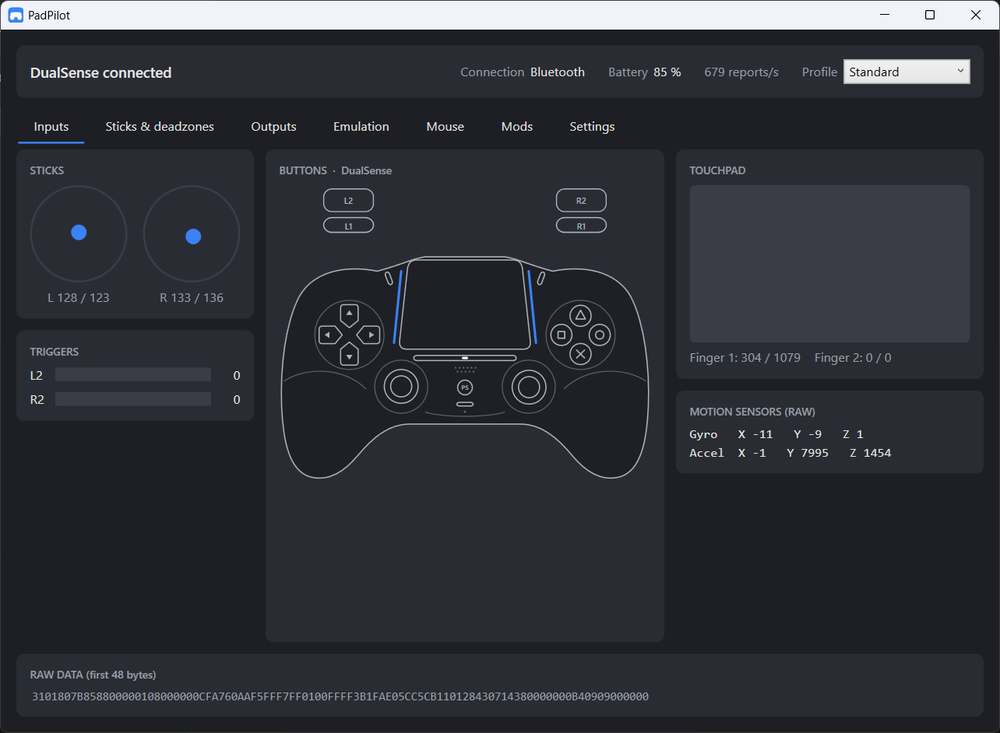
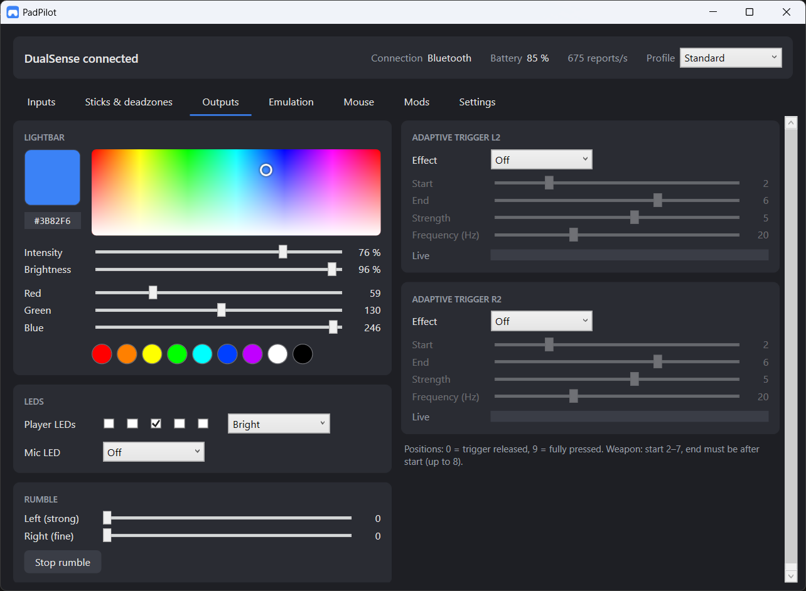
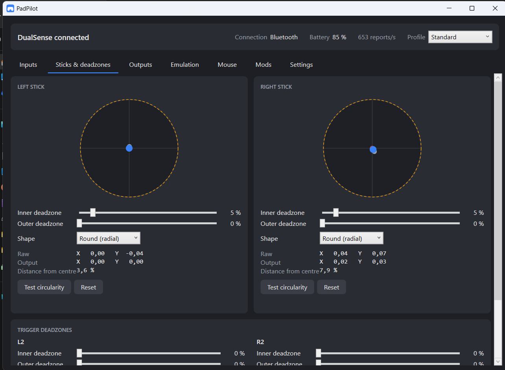

# PadPilot

**A free, open-source tool for the PlayStation 5 DualSense controller on Windows.**
Adaptive triggers, lightbar, Xbox / DualShock 4 emulation, touchpad and gyro mouse, deadzones and profiles – in one small app.



> PadPilot is an independent project and is not affiliated with Sony or Microsoft.

## Download

Get **`PadPilot.exe`** from the [latest release](../../releases/latest). The app itself is a single file – no installation, no .NET needed. Just run it.

Windows SmartScreen may warn you the first time because the file isn't code-signed: click **More info → Run anyway**.

### Requirements

- Windows 10 or 11, 64-bit
- A DualSense or DualSense Edge controller (USB or Bluetooth)

Everything except emulation works right away. **Xbox / DualShock 4 emulation needs two separate drivers:**

| Driver | Needed for | |
|---|---|---|
| **[ViGEmBus](https://github.com/nefarius/ViGEmBus/releases)** | the virtual Xbox / DualShock 4 controller | required for emulation |
| **[HidHide](https://github.com/nefarius/HidHide/releases)** | hiding the real DualSense so games don't see two controllers | optional, recommended |

PadPilot checks for both at startup. If ViGEmBus is missing, a note at the top of the window tells you so; the **Emulation** tab shows the state of both drivers with an **Install** button (via winget, asks for admin rights) and a link to the download page. Restart the PC if the installer asks for it.

Note: ViGEmBus is no longer actively developed by its author, but it keeps working on current Windows versions.

## Reporting problems

Open **Settings → Support → Copy diagnostics** and paste the text into a [new issue](../../issues/new). It contains the PadPilot and Windows version, controller model and connection type, driver versions and the main settings – nothing personal. This is especially helpful for DualSense Edge owners, as I can't test the Edge myself.

## Features

| | |
|---|---|
| **Inputs** | Live view of every button, stick, trigger, the touchpad and motion sensors; battery and charging status; USB and Bluetooth with automatic reconnect |
| **Sticks & deadzones** | Inner and outer deadzones (round or cross-shaped) for both sticks and both triggers, stick drift display, circularity test |
| **Outputs** | Lightbar with colour field, intensity and brightness; player LEDs; mic LED; rumble; adaptive triggers: resistance, section, weapon, vibration |
| **Emulation** | Games see an Xbox 360 or DualShock 4 controller; game rumble is passed to the DualSense; the real controller can be hidden automatically with HidHide |
| **Mouse** | Touchpad as mouse (move, click, right-click, two-finger scroll, tap to click); gyro as mouse with activation button and calibration |
| **Mods** | Games and mods can control triggers, lightbar, LEDs and rumble via UDP or a text file – see [docs/MOD-PROTOKOLL.md](docs/MOD-PROTOKOLL.md) |
| **Profiles** | Save complete setups (e.g. "Desktop", "Shooter") and switch from the window or the tray menu |
| **Convenience** | Start with Windows, minimize to tray, English and German UI |

<p>
  
  
</p>

## For mod developers

Send a JSON message to `127.0.0.1:6970` (UDP):

```json
{ "lightbar": "#FF0000", "rightTrigger": { "mode": "weapon", "start": 2, "end": 6, "strength": 8 } }
```

Every field is optional, every packet gets a status reply. The full protocol with examples for PowerShell, Python and C# is in [docs/MOD-PROTOKOLL.md](docs/MOD-PROTOKOLL.md) (German).

## Building from source

Requires the [.NET 8 SDK](https://dotnet.microsoft.com/download/dotnet/8.0).

```bash
dotnet build
dotnet test
dotnet run --project src/PadPilot.App
```

Single-file release build:

```bash
dotnet publish src/PadPilot.App -c Release -r win-x64 --self-contained true -p:PublishSingleFile=true -p:IncludeNativeLibrariesForSelfExtract=true -p:EnableCompressionInSingleFile=true -p:DebugType=none -o publish
```

Project layout:

```
src/PadPilot.Core/        controller protocol, emulation, mouse, mods (no UI)
src/PadPilot.App/         WPF app
tests/PadPilot.Core.Tests xUnit tests
docs/                     protocol notes and mod protocol (German)
```

## How it works

PadPilot talks to the controller directly over HID. The report layout follows the openly documented
Linux kernel driver `hid-playstation`; on Bluetooth, output reports carry a CRC32 checksum.
Virtual controllers are created with ViGEmBus, the real controller is hidden with HidHide.

## License

PadPilot is released under the [MIT License](LICENSE). Third-party libraries and trademarks: see [THIRD-PARTY-NOTICES.md](THIRD-PARTY-NOTICES.md).
